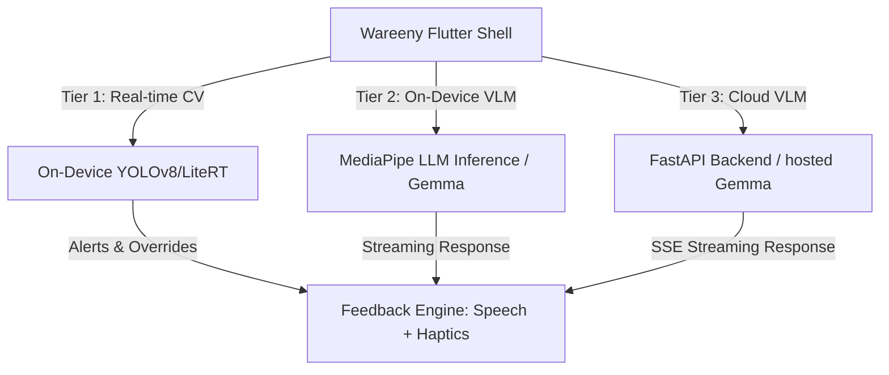

# Wareeny (وريني) 📱👁️

**Wareeny** ("Show Me" in Arabic) is a state-of-the-art, AI-powered mobile assistive application designed to empower visually impaired and blind users. It operates as a personal assistant, converting visual surroundings into rich, context-aware auditory and haptic feedback. 

Wareeny is a Bachelor Graduation Thesis Project developed at the **Future University in Egypt (FUE)**.

---

## 🌟 Core Architecture & Multi-Tier AI Runtime

Wareeny balances real-time physical safety with heavy visual reasoning using a **three-tier architecture**:



### 1. Tier 1 — Realtime Local Computer Vision (On-Device CV)
*   **Purpose**: Latency-critical safety, hazard detection, and quick searching.
*   **Tech Stack**: LiteRT (TensorFlow Lite) / `ultralytics_yolo` on dedicated worker threads.
*   **Features**:
    *   **Obstacle Avoidance**: Dynamic proximity boundaries mapped to haptic vibration pulses and spatial audio.
    *   **Traffic Light Status**: Local real-time classification (Red/Yellow/Green/Unknown) for crosswalk navigation.
    *   **Danger Word/Sign Alerts**: Scan the camera feed for danger warnings, stop signs, or hazard labels.
    *   **Stuff Finder & Lost Item Finder**: Localized object search (keys, mugs, bottles, etc.) using custom YOLOv8 models.

### 2. Tier 2 — On-Device VLM (Private & Offline)
*   **Purpose**: Conversational understanding and reading without a network connection.
*   **Tech Stack**: MediaPipe LLM Inference running a quantized `Gemma` model.
*   **Features**:
    *   **Offline Reading**: Natural document scanning, text parsing, and conversational speaking.
    *   **In-Hand Object Identification**: Private recognition of personal items.
    *   **Currency & Brand Reader**: Swift identification of local banknotes and product branding.

### 3. Tier 3 — Cloud VLM (Complex Reasoning Fallback)
*   **Purpose**: Heavy visual QA and detailed scene description.
*   **Tech Stack**: Remote FastAPI backend fronting an Ollama-hosted vision-capable `Gemma 4` model, streaming tokens to the client over Server-Sent Events (SSE).
*   **Features**:
    *   **Scene Description**: Detailed "what's in front of me" explanations.
    *   **Interactive Visual Q&A (One-shot)**: Ask specific questions about the captured frame using Speech-To-Text (STT) and receive spoken answers.

---

## 📁 Repository Directory Structure

```directory
Wareeny/
├── assets/                     # On-device model files and static resources
│   └── models/                 # YOLOv8 .tflite / .mlpackage models
├── backend/                    # Python FastAPI Server (Cloud Tier VLM)
│   ├── main.py                 # FastAPI application and Ollama streaming route
│   ├── requirements.txt        # Backend python dependencies
│   └── HOSTING.md              # Backend deployment guidelines
├── docs/                       # Architecture diagrams and documentation
│   ├── architecture/           # Deep-dives into Object Detection & Bridges
│   └── ROADMAP.md              # Detailed implementation phases
├── lib/                        # Flutter Mobile Application Source Code
│   ├── main.dart               # App entry point (redirects to bootstrap)
│   ├── app/                    # Root configuration and bootstrap logic
│   ├── core/                   # Shared configurations and infrastructure
│   │   ├── config/             # Environment values (Dev / Prod)
│   │   ├── di/                 # Dependency injection and Service Registry
│   │   ├── emergency/          # Shake sensors, location, and emergency contacts
│   │   └── theme/              # Colors, styling, and typography design tokens
│   ├── presentation/           # UI widgets, Controllers, and Screen Layouts
│   │   ├── camera/             # Low-level camera feed surfaces
│   │   ├── emergency/          # Danger overlay and trigger triggers
│   │   ├── navigation_mode/    # Compass, risk analysis, and navigation controller
│   │   ├── onboarding/         # Onboarding guides for emergency contact setup
│   │   ├── read/               # OCR scanner, Speech Queue, and VLM controllers
│   │   ├── settings/           # Contact config and local model downloads
│   │   └── stuff_finder/       # Stuff finder screens and YOLO target selectors
│   └── shared/                 # Core shared utilities, adapters, and engines
│       ├── bridges/            # Platform channels (TTS, Haptics, Camera, Battery)
│       ├── navigation/         # Risk assessment engine and audio feedback
│       ├── object_detection/   # YOLO coordinate mapper and detections
│       └── vlm/                # Cloud/Local VLM providers and task router
└── test/                       # Comprehensive unit and widget testing suites
```

---

## ⚙️ Tech Stack & Key Technologies

*   **Mobile Framework**: Flutter (Dart)
*   **Local CV**: LiteRT / TFLite (YOLOv8)
*   **Local VLM**: MediaPipe GenAI LLM Inference (Gemma)
*   **Web Framework**: FastAPI (Python 3.10+)
*   **LLM server**: Ollama
*   **Local Database**: SQLite (`shared_preferences` & native stores)
*   **Sensors**: CoreMotion/Android Sensors (Geolocator, Sensors Plus for shake detection)

---

## 🚀 Getting Started

### 📋 Prerequisites
*   [Flutter SDK](https://docs.flutter.dev/get-started/install) (v3.12.0 or higher recommended)
*   [Python 3.10+](https://www.python.org/downloads/)
*   [Ollama](https://ollama.com/) (For cloud-tier local testing)

---

### 💻 Running the Client App (Flutter)

1.  **Clone the repository** and navigate to the project directory:
    ```bash
    cd Wareeny
    ```
2.  **Fetch Flutter packages**:
    ```bash
    flutter pub get
    ```
3.  **Run the app**:
    *   *Development environment*:
        ```bash
        flutter run --dart-define=APP_ENV=dev
        ```
    *   *Production environment*:
        ```bash
        flutter run --dart-define=APP_ENV=prod
        ```
    *   *Targeting custom local backend IP (for physical device testing)*:
        ```bash
        flutter run --dart-define=API_BASE_URL=http://<YOUR_LAN_IP>:8000
        ```

---

### 🐍 Running the Cloud VLM Backend (FastAPI)

The backend relays high-resolution captures to the cloud VLM when the local device cannot execute a complex prompt locally.

1.  **Navigate to the backend directory**:
    ```bash
    cd backend
    ```
2.  **Set up virtual environment & install dependencies**:
    ```bash
    python -m venv .venv
    # On Windows:
    .venv\Scripts\activate
    # On macOS/Linux:
    source .venv/bin/activate
    
    pip install -r requirements.txt
    ```
3.  **Pull the Vision Model via Ollama**:
    Ensure Ollama is running, then pull the model:
    ```bash
    ollama pull gemma4:e4b
    ```
4.  **Set up Environment variables**:
    Copy `.env.example` to `.env` and adjust the variables if your Ollama instance is hosted elsewhere:
    ```bash
    cp .env.example .env
    ```
5.  **Start the FastAPI development server**:
    ```bash
    uvicorn main:app --host 0.0.0.0 --port 8000 --reload
    ```

---

## 🧪 Testing

Wareeny includes modular unit tests for controllers, detection coordinate mappers, and risk calculation engines:

```bash
# Run all Dart & Flutter tests
flutter test
```

Important test files to reference:
*   `test/presentation/navigation_mode/navigation_controller_test.dart`
*   `test/presentation/stuff_finder/stuff_finder_controller_test.dart`
*   `test/shared/navigation/navigation_risk_engine_test.dart`

---

## 📚 Canonical Documentation

All authoritative technical documentation lives in [`docs-canonical/`](docs-canonical/). These files are reverse-engineered from the source code and kept in sync as the codebase evolves.

| Document | Contents |
|---|---|
| [ARCHITECTURE.md](docs-canonical/ARCHITECTURE.md) | System overview, three-tier AI runtime, tech stack, platform channel map |
| [DATA-MODEL.md](docs-canonical/DATA-MODEL.md) | Local persistence schema, all data classes and enums |
| [API-SPEC.md](docs-canonical/API-SPEC.md) | FastAPI endpoints, native platform channel contracts, VLM provider interface |
| [ENVIRONMENT.md](docs-canonical/ENVIRONMENT.md) | Local setup, all environment variables (Flutter build-time + backend `.env`) |
| [FEATURES.md](docs-canonical/FEATURES.md) | Implemented user flows: Navigation, Read, Stuff Finder, Emergency SOS, Settings |

---

## 📜 Development Guidelines & Project Rules

*   **Feedback Priority Queue**: Safety alerts (obstacles, danger signs) always take priority and immediately interrupt running TTS descriptions. See `lib/shared/navigation/navigation_feedback.dart`.
*   **Mode Isolation**: Only one heavy inference mode (Real-time CV / VLM) can run hot at a single time to preserve battery and prevent thermal throttling.
*   **Code Quality**: Always maintain clean architectures, separate controllers from screen overlays, and route system bridges through channels. Read [CLAUDE.md](file:///d:/Wareeny/CLAUDE.md) and `RULES.md` for specific formatting guidelines.
